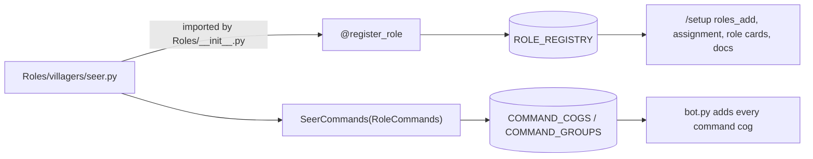
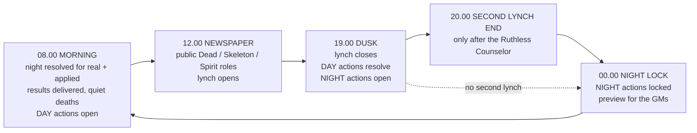
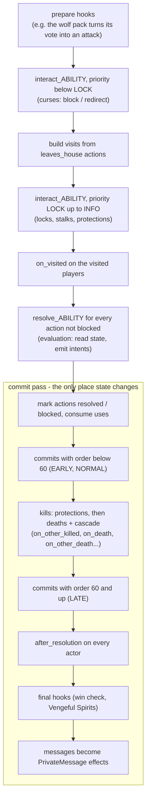
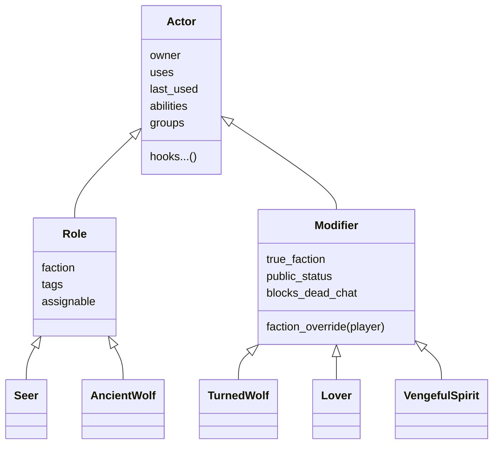

# Developer guide — adding a role

This guide explains how to add (or change) a role. For how the pieces underneath fit together, see
[Developer guide - architecture and data](Developer%20guide%20-%20architecture%20and%20data.md).

**Contents**
1. Quick start
2. Requirements checklist
3. Declaring abilities
4. The resolution pipeline (what runs when)
5. Hook reference
6. The `ctx` toolbox
7. Other helpers
8. Roles vs modifiers
9. Commands
10. Settings and GM overrides
11. Testing a role
12. Worked example: the Watchman

---

## 1. Quick start

A role is **one file** in `Roles/<faction>/<role_name>.py`. Every module under `Roles/` is imported automatically
at startup (`Roles/__init__.py`), so there is nothing to register anywhere else. To remove a role, delete its
file. A running game that still has that role keeps its data (see `MissingActor` in the architecture guide).

A role file has two parts:

```python
from Roles.role import *          # everything a role needs, in one import


@register_role                    # turns the class into a dataclass and registers it
class Seer(Role):
    # 1. identity & rules (pure Python, no Discord)
    name = "seer"
    display = "Seer"
    faction = VILLAGERS
    tags = frozenset({"villager_role"})
    description = "Each night, learn the faction of one player..."
    abilities = (
        Ability("check", Timing.NIGHT, "Learn a player's faction",
                params=(P.living("target", "Who to look into"),), priority=Priority.INFO),
    )

    checked: list[int] = field(default_factory=list)      # role state - saved automatically

    def resolve_check(self, ctx: Resolution, action: SubmittedAction) -> None:
        target = ctx.target_of(action)
        ctx.inform(self.owner, f"{ctx.state.name(target)} is {ctx.apparent_faction(target, self.name)}")
        ctx.commit(lambda: self.checked.append(target))   # change state only through commit


# 2. the slash commands (thin wrappers)
class SeerCommands(RoleCommands, group_name="seer", source="seer"):
    @app_commands.command(name="check", description="Learn a player's faction tonight")
    async def check(self, interaction: discord.Interaction, target: discord.Member) -> None:
        await self.use(interaction, "check", target=target)
```

After adding or changing a role:

```bash
python tools/generate_docs.py
```

```bash
python -m pytest
```

The first regenerates `Docs/Player commands.md` from your role's description and abilities. Run the second
afterwards: the tests check that every role and its state round-trip through the database, that every role has
a role card and a docs entry, that every ability has a command group, and that the command tree fits Discord's
limits.



---

## 2. Requirements checklist

| Requirement | Why |
|---|---|
| A unique `name` (snake_case) | It's the key in `ROLE_REGISTRY`, the database, the role pool and the commands. |
| `display`, `faction`, `description` | The description is posted as the role card and used in the player guide. |
| `abilities = (...)` | A tuple of `Ability` declarations; it drives validation, timing, docs and help texts. |
| State as annotated fields **with defaults** | `register_role` makes the class a dataclass. Use `field(default_factory=list)` for lists and dicts. |
| JSON-friendly field types | `int`, `str`, `bool`, `None`, lists, dicts with str/int keys, enums, other dataclasses. Store players as **user ids**, never `Player` objects. |
| A `RoleCommands` subclass with `source="<name>"` | Without it players can't use the abilities (`tests/test_docs.py` fails). |
| Resolvers don't change state directly | Read state freely; change it in `ctx.commit(...)` (or in commit-pass hooks). |
| Use `ctx.target_of(action)` | Not `action.target`: curses and the Ancient wolf can redirect actions. |
| Use `ctx.apparent_faction` / `apparent_role` for investigations | So the Cultist, Grave Robber and Changeling can look different. |
| `assignable = False` for roles nobody starts with | E.g. the plain `werewolf`. These aren't in the default role pool. |

The default role pool is one of every assignable role (three Brothers). If a new role should appear more than
once by default, add it to `DEFAULT_COUNTS` in [Core/flow.py](../Core/flow.py). To keep it out of the default
pool, add it to `NOT_IN_DEFAULT`.

---

## 3. Declaring abilities

`Ability` lives in [Core/abilities.py](../Core/abilities.py):

```python
Ability(
    "protect",                 # key: resolve_protect / interact_protect, `/silver_angel protect`
    Timing.NIGHT,              # when it can be used and when it resolves (see below)
    "Protect a player tonight",
    params=(P.living("target", "Who to protect", allow_self=True),),
    priority=Priority.PROTECT, # order within the resolution
    leaves_house=True,         # counts as leaving the house (Bloodhound, Wanderer, locks, stalks...)
    visits="target",           # which param is the house visited (None = leaves without visiting anyone)
    uses=None,                 # per game; None = unlimited. GMs can override: /setup role_setting x uses.protect 3
    once_per_cycle=True,       # INSTANT abilities: once per day
    usable_while_dead=False,   # e.g. the Vengeful Spirit
    phases=(),                 # INSTANT only: allowed phases ("day", "night", "sleep")
    consume_on_block=False,    # does a blocked attempt cost a use?
    first_day=False,           # nothing happens on day 1 unless this is True
)
```

**Parameter helpers (`P`).** These are validated before your code ever sees them:

| Helper | Stored value | Checked |
|---|---|---|
| `P.living(name, desc, allow_self=False)` | user id | exists, alive, not self (unless allowed) |
| `P.dead(...)` | user id | dead (not a living skeleton) |
| `P.any_player(...)` | user id | exists |
| `P.role(...)` | role name | known role |
| `P.choice(name, ("a", "b"), desc)` | lower-case choice | one of the choices |
| `P.text(name, desc, max_words=20)` | text | word limit |
| `P.time(...)` | `"HH:MM"` | valid time |
| `P.family(...)` | group key | is a family |

Every param can be `required=False`. Player params end up in `action.targets`, in declaration order, and every
param is in `action.params`.

**Timing decides when an action resolves:**

| Timing | Can be used | Resolves | Results arrive |
|---|---|---|---|
| `NIGHT` | 19:00–00:00 | night lock (00:00) — preview | 08:00 |
| `DAY` | 08:00–19:00 | dusk (19:00) | 19:00 |
| `ANYTIME` | always | the next resolution moment | 19:00 or 08:00 |
| `INSTANT` | in `phases` | immediately | immediately |

Using the same ability again before it resolves **replaces** the earlier choice. A player can cancel with
`self.cancel(...)`.



---

## 4. The resolution pipeline (what runs when)

Night, dusk and instant actions all go through the same pipeline: `Resolution.run()` in
[Core/resolution.py](../Core/resolution.py).



**The simultaneity rule.** Everything resolving at the same moment reads the state *as it was at the start* of
that moment. During evaluation (`resolve_*`) you only read. You produce intents with `ctx.inform`, `ctx.kill` and
`ctx.commit`. That's why a Seer still sees "Villagers" for someone the Ancient wolf turns the same night. The only
interactions that affect other actions in the same resolution are the explicitly modelled ones: curses, locks,
stalks, protections and visits. Those happen in the interaction pass.

**Which method for what:**
- `interact_<ability>` blocks, redirects or protects. It runs in priority order, before evaluation. If it needs
  to change state, use `ctx.commit` too.
- `resolve_<ability>` learns things, kills, converts and informs. Most abilities only need this.
- An ability can have both (e.g. the Ancient wolf). Neither runs if the action was blocked.

**Priorities** (`Priority` in [Core/abilities.py](../Core/abilities.py)): CURSE 5, LOCK 10, STALK 15, PROTECT 20,
INFO 30, CONVERT 40, KILL 50, POST 70. Ties are broken by submission time.

The preview at 00:00 runs this whole pipeline on a **deep copy** of the state, with a stored seed. At 08:00 it
runs again for real with the same seed, so the outcome matches the preview unless something changed in between.

---

## 5. Hook reference

Every role and modifier is an `Actor` ([Core/actor.py](../Core/actor.py)). Override only what you need; every hook
is synchronous and must not touch Discord.

| Hook | Called | On | Typical use |
|---|---|---|---|
| `available_abilities(state)` | listing / submitting | the owner | conditional abilities (Apprentice, Monster Hunter, Fox) |
| `validate(state, action)` | at submit, after the generic checks | the owner | "not twice in a row", "only last night's dead" — raise `GameError` |
| `interact_<ability>(ctx, action)` | interaction pass | the owner's action | curse, lock, stalk, protect |
| `resolve_<ability>(ctx, action)` | evaluation pass | the owner's action | info, kills, conversions |
| `on_visited(ctx, visit)` | after movement | the visited player's actors | react to visitors |
| `protects_against(ctx, kill)` → reason | every kill check | the target's actors | Cupid vs lynch, Lich "only by lynch" |
| `on_kill_prevented(ctx, kill)` | a kill or turn on the owner was stopped | the target's actors | Old Hunter's wolfsbane |
| `on_other_killed(ctx, kill)` | a kill is confirmed, just before the death | **every** actor | collateral (the Village Slut), counting kills (Spawn) |
| `on_death(ctx, record)` | the owner died | the dead player's actors | Lich takes the skeletons along, lover → Vengeful Spirit |
| `on_other_death(ctx, dead)` | someone else died | **every** actor | heartbreak, Apprentice offer, Cupid → villagers |
| `on_other_converted(ctx, player, kind, by)` | a conversion happened | **every** actor | the Slut turned along, a lovers' bond broken |
| `on_revived(ctx)` | the owner was revived | the revived player's actors | a revived lover loses the bond |
| `after_resolution(ctx)` | last step of every resolution | **every** actor | per-night bookkeeping (check `ctx.kind == "night"`) |
| `on_game_start(state)` | `/game start` | every actor | the Normal wolf hint, the coven kill list |
| `apparent_faction(state, observer)` / `apparent_role(...)` | investigations | the target's actors | Cultist looks like a villager; return `None` for no opinion |
| `defeats_stalkers(state, action)` | the Shadow wolf meets someone leaving | the stalked player's actors | Vigilante, armed Monster Hunter |
| `provides(source)` / `command_source(key)` | finding abilities for a command | the owner | the Actor answering `/seer check` |

Hooks marked **every** actor fire for all actors in the game, so check that the event concerns you
(`if dead.user_id != self.partner: return`). `on_other_death`, `on_other_killed` and `after_resolution` also run
for actors of *dead* players.

---

## 6. The `ctx` toolbox

`ctx` is the `Resolution`. The most used members:

**Reading**

| Member | Gives |
|---|---|
| `ctx.state` | the `GameState` (read in `resolve_*`; change only in commits) |
| `ctx.kind` / `ctx.slot` | `"night"`, `"dusk"`, `"instant"`, `"lynch"` / e.g. `"night:3"` |
| `ctx.target_of(action, param="target")` | the (possibly redirected) target |
| `ctx.apparent_faction(pid, observer)` / `ctx.apparent_role(...)` | what an investigation sees |
| `ctx.visitors_of(pid)` | visits that reached that player (not blocked) |
| `ctx.visits_by(pid)` / `ctx.left_house(pid)` | movement; a blocked exit still counts as leaving |
| `ctx.actions_by(pid)` / `ctx.action_of(source, ability)` / `ctx.ability_of(action)` | other actions this resolution |
| `ctx.flags` | a scratch dict shared by everything in this resolution |
| `ctx.choice(ids)` / `ctx.rng` | seeded randomness (preview = final); never use `random` directly |

**Intents**

| Member | Does |
|---|---|
| `ctx.inform(pid, text)` | private message, delivered when the resolution is applied |
| `ctx.kill(target, cause, killers=, killer_role=, attacker_faction=, enters_house=True, unstoppable=False, public=False, action=)` | queue a kill; returns the `Kill` (check `kill.prevented_by` in a LATE commit) |
| `ctx.protect(target, label, applies=lambda kill: ..., first=False)` | register a protection (interaction pass) |
| `ctx.block(action, reason)` | stop an action (and its visit) |
| `ctx.redirect(action, new_target, reason=)` | change an action's target |
| `ctx.commit(fn, order=Resolution.EARLY / NORMAL / LATE)` | run `fn` in the commit pass; LATE runs after deaths |
| `ctx.convert(kind, target, by=)` | apply a registered conversion and notify everyone (`register_conversion`) |
| `ctx.turn_prevented(target, attacker_faction=, killers=)` | do protections stop a turn? |
| `ctx.claim(kind, target, me)` + `ctx.claim_winner(kind, target)` | competing claims (Ancient wolf vs Vampire Lord), seeded |
| `ctx.keep_use(action)` / `actor.refund(key)` | don't charge a use / give one back |
| `ctx.note(section, text)` / `ctx.newspaper(text)` | lines in the GM report / newspaper notes |
| `ctx.revive(pid, reason=)` | revive (in a commit) |

**`Kill` fields that matter for interactions:**
- `enters_house`: locks and "not home" apply. Heartbreak, guilt and GM kills don't enter.
- `unstoppable`: ignores all protections (heartbreak, GM kills).
- `attacker_faction`: e.g. the Silver Angel only stops evil attackers.
- `public`: lynches are public immediately.

---

## 7. Other helpers (all available through `from Roles.role import *`)

| Helper | From | Use |
|---|---|---|
| `set_role(state, player, name, keep_faction=, note=, reason=)` | `Core/flow.py` | give a fresh role (Grave Robber) — emits a role card |
| `adopt_role(state, player, role, reason=, note=)` | `Core/flow.py` | give a *copy* of a role instance, charges included (Apprentice) |
| `add_modifier(state, player, name, reason=, **fields)` / `remove_modifier(...)` | `Core/flow.py` | stackable additions (Lover, Turned wolf) |
| `add_status(state, player, key, source=, expires="morning:5", **data)` | `Core/flow.py` | temporary markers. Key `"protection"` with `label=`, `turn=` is a night protection checked automatically (Priest, Enchantress). |
| `join_group(state, player, key)` / `register_group(key, kind, channel_name)` | `Core/flow.py` | shared chats; or declare `groups = ("wolves",)` on the class |
| `state.ensure_group(key, kind, name)` | `Core/state.py` | a chat made during the game (the channel is created automatically) |
| `state.house_of(pid)` / `state.house_members(house)` / `state.housemates(pid)` | `Core/state.py` | a house is a family |
| `state.player(pid)`, `state.name(pid)`, `state.alive_players()`, `state.players_with_role(name)` | `Core/state.py` | lookups |
| `seed(state, key)` | `Core/flow.py` | a stored seed for one-off randomness (Normal wolf hint) |
| `PrivateMessage`, `RoleCard`, `GroupMessage`, `Announcement` (`state.emit(...)`) | `Core/effects.py` | messages outside `ctx.inform` |
| `register_conversion(kind, fn)` / `CONVERSIONS` | `Core/resolution.py` | define a conversion (`werewolf`, `vampire`, `skeleton`, `changeling`) |
| `register_prepare_hook(fn)` / `register_final_hook(fn)` | `Core/resolution.py` | game-wide rules (wolf pack, first-death spirits) |
| `flow.create_decision(...)` + `flow.DECISION_HANDLERS[kind] = fn` | `Core/flow.py` | ask a player (or the GMs) to choose via a menu |
| `realtime.schedule_relay`, `open_seance`, `ask_player`, `send_telepathy` | `Core/realtime.py` | eavesdropping, yes/no questions, anonymous messages |
| `self.player(state)`, `self.setting(state, key, default)`, `self.uses_left(...)` | `Core/actor.py` | on every actor |

Shared code for several roles goes in an underscore module, e.g. `Roles/werewolves/_pack.py` or
`Roles/coven/_coven.py`. Those modules are imported too.

---

## 8. Roles vs modifiers



- A player has exactly **one Role** and any number of **Modifiers**.
- Use a modifier for something **acquired and stackable** that should keep the role working: Turned wolf,
  Vampire Spawn, Lover, Skeleton, Changeling, Vengeful Spirit. Register it with `@register_modifier`.
- `true_faction` (or `faction_override(player)`) changes the player's faction; the most recently added override
  wins. `public_status` gives a public Discord role. `blocks_dead_chat` keeps a dead player out of the dead chat.
- Modifiers can have abilities and commands too (the Vengeful Spirit's `/vengeful_spirit avenge`).

---

## 9. Commands

```python
class WitchCommands(RoleCommands, group_name="witch", source="witch"):
    @app_commands.command(name="poison", description="Use your potion of death tonight")
    @app_commands.describe(target="Who to poison")
    async def poison(self, interaction: discord.Interaction, target: discord.Member) -> None:
        await self.use(interaction, "poison", target=target)
```

- `self.use(interaction, ability_key, **params)` does everything:
  - finds the player and checks the ability is available to them right now;
  - checks the phase, sleep time, uses and parameters, then `validate`;
  - stores the action, saves, logs and replies.

  Members become user ids automatically, and `app_commands.Choice` becomes its value.
- `self.cancel(interaction, ability_key)` cancels a pending action.
- `GameError("message")` raised anywhere ends up as a red ephemeral reply, and is logged as rejected.
- Shared commands for several roles: a base with `abstract=True`. See `CovenCommands` in `Roles/coven/_coven.py`:
  every coven role's group gets `/find` and `/kill_list`.
- Autocomplete for role names: `@app_commands.autocomplete(role=role_autocomplete)`.
- Discord limits: at most 25 subcommands per group, lower-case names of up to 32 characters, descriptions of up
  to 100 characters. `tests/test_services.py` checks these.

---

## 10. Settings and GM overrides

Every number can be changed per game by a GM, without code changes:

```python
nights = self.setting(state, "nights", 3)      # /setup role_setting vengeful_spirit nights 2
```

`uses.<ability>` is applied automatically, e.g. `/setup role_setting feral_wolf uses.eat 4`.

---

## 11. Testing a role

[tests/builder.py](../tests/builder.py) makes a game scenario a few lines long. These are all pure engine calls,
with no Discord and no database.

| Builder call | Does |
|---|---|
| `g.players(name="role", ...)` | add players with roles |
| `g.families(("a", "b"), ("c",))` | form families (houses) |
| `g.start()` | day 1 |
| `g.dusk()` / `g.lock()` / `g.morning()` / `g.night()` / `g.newspaper()` / `g.second_lynch_end()` | transitions |
| `g.act("name", "ability", target="other", ...)` | submit an action (names become ids) |
| `g.wolf_vote("w", "victim")` / `g.vote("voter", "target")` | votes |
| `g.alive("name")`, `g.p("name")`, `g.id("name")` | inspect |
| `g.messages_for("name")` / `g.last_report()` | what a player was told / the GM report |

Two pitfalls:
- Don't give a player the same name as a role. `g.act(..., role="seer")` would turn `"seer"` into that player's id.
- The first death in a game creates a Vengeful Spirit. Set `g.state.data["first_death_seen"] = True` if that
  gets in the way of your scenario.

---

## 12. Worked example: the Watchman

The **Watchman** is a made-up role. Every other night they watch someone's door and learn how many people visited
that player. This example was tested, but the role isn't part of the game.

**`Roles/villagers/watchman.py`:**

```python
from Roles.role import *


@register_role
class Watchman(Role):
    name = "watchman"
    display = "Watchman"
    faction = VILLAGERS
    tags = frozenset({"villager_role"})
    description = (
        "Every other night you can keep watch outside someone's door: the next morning you learn how many people "
        "visited them. Keeping watch means leaving your own house."
    )
    abilities = (
        Ability(
            "watch", Timing.NIGHT, "Count how many people visit a player tonight",
            params=(P.living("target", "Whose door to watch"),),
            priority=Priority.INFO, leaves_house=True,
        ),
    )

    rested_until: int = 0   # the first day (night) the watch can be kept again

    def available_abilities(self, state: GameState) -> list[Ability]:
        # rests every other night - unavailable abilities simply don't show up
        return super().available_abilities(state) if state.day >= self.rested_until else []

    def resolve_watch(self, ctx: Resolution, action: SubmittedAction) -> None:
        target = ctx.target_of(action)                     # respects curses / redirects
        visitors = {v.visitor for v in ctx.visitors_of(target) if v.visitor != self.owner}
        ctx.inform(self.owner, f"**{ctx.state.name(target)}** had **{len(visitors)}** visitor(s) last night.")
        ctx.commit(lambda: setattr(self, "rested_until", ctx.state.day + 2))   # state changes in a commit


class WatchmanCommands(RoleCommands, group_name="watchman", source="watchman"):
    @app_commands.command(name="watch", description="Count how many people visit a player tonight")
    @app_commands.describe(target="Whose door to watch")
    async def watch(self, interaction: discord.Interaction, target: discord.Member) -> None:
        await self.use(interaction, "watch", target=target)
```

What it gets for free:
- It's blocked when locked in, stalked or cursed, and the GM report says why.
- The Trapmaker can catch the Watchman, because it visits its target.
- The Bloodhound sees it leave the house.
- Uses can be changed by the GMs.
- There's a role card and a player-guide entry.
- `/me` shows when the ability is available.

**`tests/test_watchman.py`:**

```python
import pytest

from Core.errors import GameError
from tests.builder import GameBuilder


def test_watchman_counts_visitors_and_rests():
    g = GameBuilder()
    g.players(watch="watchman", w1="normal_wolf", w2="normal_wolf", slut="village_slut", v="villager")
    g.start(); g.dusk()
    g.act("watch", "watch", target="v")
    g.act("slut", "visit", target="v")
    g.wolf_vote("w1", "slut"); g.wolf_vote("w2", "slut")   # the slut isn't home - she's at v's
    g.night()
    assert "**v** had **1** visitor(s)" in g.messages_for("watch")[-1]
    g.newspaper(); g.dusk()
    with pytest.raises(GameError):
        g.act("watch", "watch", target="v")                # resting tonight
    g.night(); g.newspaper(); g.dusk()
    g.act("watch", "watch", target="v")                    # back on duty
```

Then run:

```bash
python tools/generate_docs.py
```

```bash
python -m pytest
```
