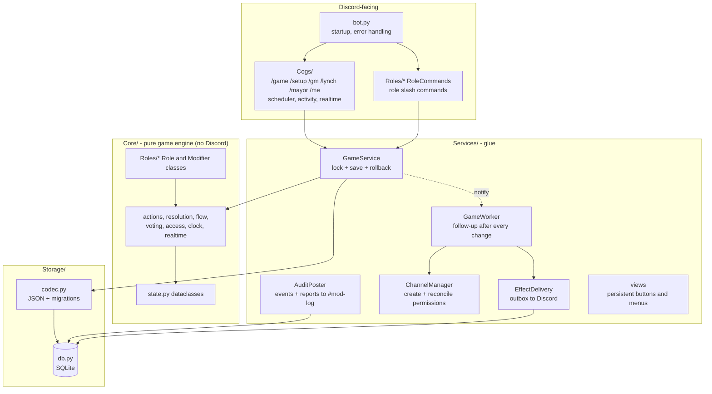
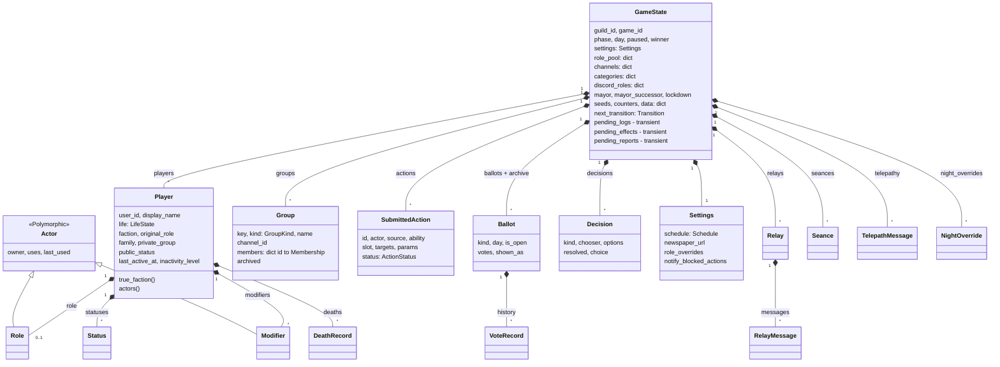
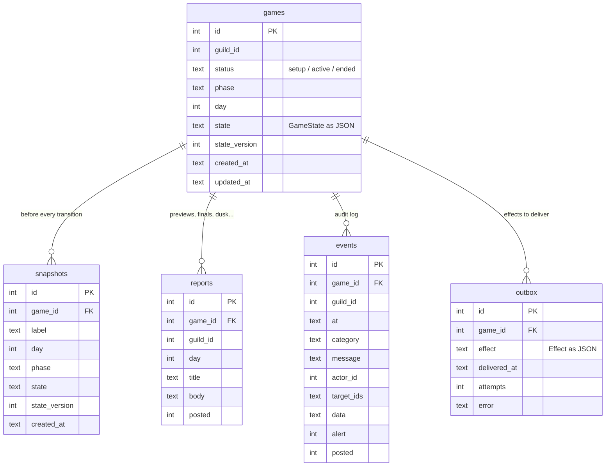
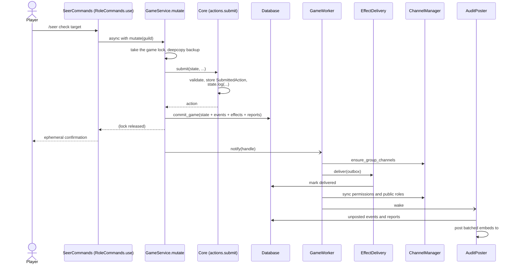
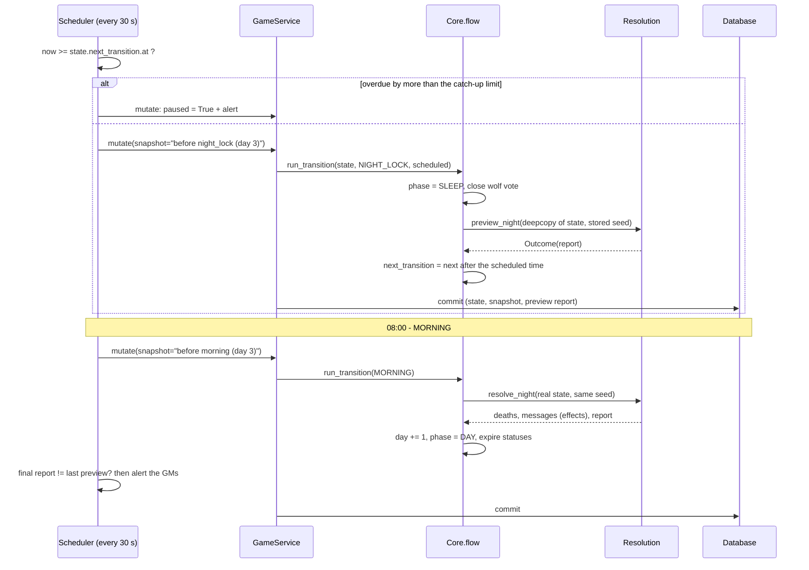
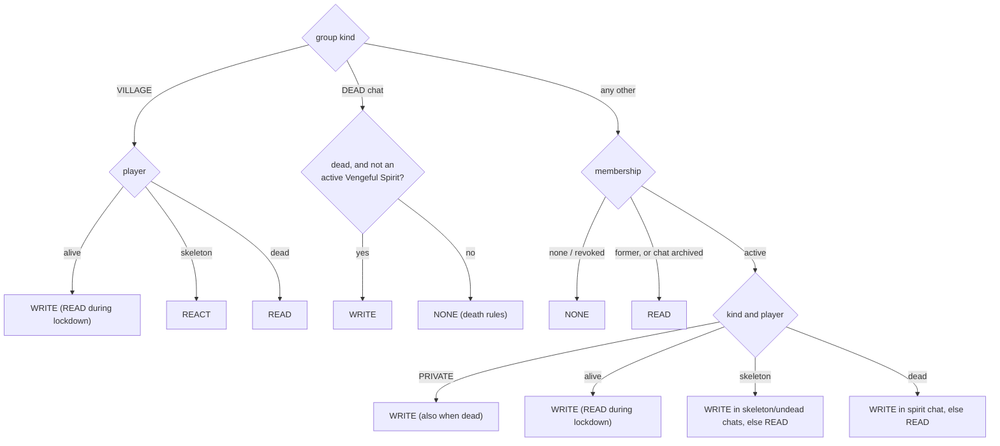

# Developer guide — architecture and data

This guide covers how the bot is put together: the layers, the game-state dataclasses, how state reaches the
database, and what happens between a player's command and a message in Discord. For writing roles, see
[Developer guide - adding a role](Developer%20guide%20-%20adding%20a%20role.md).

**Contents**
1. Layers
2. The state model
3. Serialisation
4. The database
5. Life of a change
6. A phase transition
7. Effects and the outbox
8. Channel access
9. Registries and extension points
10. Where to change what

---

## 1. Layers



**The dependency rule:** `Core/` never imports `discord` or `Services/`. The engine only changes dataclasses and
queues *effects* (data saying "post this message"). That's why the whole game can be tested without Discord or a
database, and why a night can be previewed on a copy.

Shared service instances live on `runtime` in [Services/runtime.py](../Services/runtime.py) (`runtime.games`,
`runtime.db`, `runtime.channels`, ...). They're set up in `WerewolvesBot.setup_hook` in [bot.py](../bot.py).

---

## 2. The state model

Everything about one game is a single `GameState` object ([Core/state.py](../Core/state.py)). Players and channels
are referenced **by id only** (Discord user ids, channel ids), so the state can be stored as JSON, deep-copied for
the night preview and snapshotted for rollbacks. The Discord layer looks the objects up from the ids.



Some concepts that aren't obvious from the field names:

- **Life states.** `ALIVE`, `DEAD`, `SKELETON` (raised by the Lich: not alive, not dead) and `PERMA_DEAD` (a
  skeleton that died again).
- **Factions.** `player.faction` is the base faction. `player.true_faction()` lets modifiers override it; the most
  recently added override wins. Investigations use `apparent_faction`, which roles can disguise.
- **Groups are every shared chat**, including private channels (`PRIVATE`), the village (`VILLAGE`) and the dead
  chat (`DEAD`). Leaving a group sets the membership to `FORMER` (read-only), never removes it. `archived` makes
  the whole chat read-only.
- **Houses are families.** `state.house_of(pid)` returns the family's group key (or `house:<id>` for a player
  without a family). Locks, blessings, the Insomniac and the Diviner all work per house.
- **Actions** are stored as data. `slot` says when an action resolves (`night:3`, `dusk:3` or `instant`).
  `status` records what happened (pending, replaced, cancelled, resolved, blocked, failed). Old actions are kept
  for the record.
- **`state.data`** is a free-form dict for game-wide role data (the coven kill list, coven links, the
  first-death flag...). Keys must be strings.
- **Transient fields.** `pending_logs`, `pending_effects` and `pending_reports` are never stored as state. They
  are what `state.log(...)`, `state.emit(...)` and `state.report(...)` collect during one change. The service
  writes them to their own tables in the same transaction, then clears them.

---

## 3. Serialisation

[Core/serialize.py](../Core/serialize.py) converts any dataclass tree to JSON-friendly data and back.

- `dump(obj)` handles dataclasses, enums (stored as their value), lists, sets, dicts (int and enum keys become
  strings) and plain values. Fields declared with `transient(...)` are skipped.
- `load(Type, data)` uses the class's type hints to rebuild everything, including `dict[int, Player]` keys,
  enums, `X | None` and nested dataclasses.
- **Polymorphism.** A class family deriving from `Polymorphic` is written with a `"__type__"` tag. A field typed as
  `Role` then comes back as a `Seer`, `Witch` and so on. Families: `"actor"` (roles and modifiers, tagged by
  `name`) and `"effect"` (tagged by class name).
- **Forgiving by design.** Missing fields get their defaults and unknown keys are ignored, so adding a field to a
  role never breaks a stored game. A stored role whose class no longer exists (its file was deleted) loads as
  `MissingActor`, which keeps the raw data and writes it back unchanged.

[Storage/codec.py](../Storage/codec.py) wraps this into `encode(state) -> str` and `decode(text, version)`. When a
change needs more than "missing field gets its default", bump `STATE_VERSION` and add a migration. For example:

```python
STATE_VERSION = 2

def _v1_categories(data):        # v1 kept one flat list of categories; v2 keeps them per kind
    old = data.get("categories") or []
    return {**data, "categories": {"legacy": old} if isinstance(old, list) and old else {}}

MIGRATIONS = {1: _v1_categories}  # from version -> to version + 1
```

---

## 4. The database

SQLite (WAL mode) through `aiosqlite`, in [Storage/db.py](../Storage/db.py). There is one connection; every write
goes through `Database.write_lock`, so writes from different coroutines never mix inside one transaction.



| Table | Written | Read / updated |
|---|---|---|
| `games` | `create_game`; every change via `commit_game` (the whole state, one row) | on startup (`active_games` loads every stored game, ended ones too) |
| `snapshots` | before every transition, before game start/end, before a rollback | `/gm clock snapshots`, `/gm clock rollback` |
| `reports` | with the change that produced them | the AuditPoster posts them and sets `posted` |
| `events` | `state.log(...)` (same transaction), or `add_event` (rejected commands, errors, permission syncs) | the AuditPoster posts them; `/gm log` searches them |
| `outbox` | `state.emit(...)` (same transaction) | EffectDelivery sets `delivered_at`, or counts `attempts` and records the `error` |

**One transaction per change.** `commit_game` writes the new state, its events, effects, reports and (if asked) the
snapshot of the previous state together. A crash can't leave a saved state without its messages, or messages
without their state.

**Nothing is deleted while a game exists.** Ended games stay in the database and are reloaded after a restart.
Only `/game delete` removes the game's rows from all five tables, after a confirmation. There is one game per
server at a time: `/game create` refuses until the previous game is deleted.

---

## 5. Life of a change

A player uses `/seer check target:Alice`:



**When something fails:**
- If anything inside `mutate` raises (a `GameError` from validation, a bug, or a database error), the state is
  restored from the backup and nothing is saved.
- A `GameError` becomes a red ephemeral reply and a `REJECTED` event.
- Any other exception becomes an `ERROR` event that pings the GMs, and the traceback goes to `logs/bot.log`.

**Commands and the scheduler never interleave:** both go through `mutate`, which holds the game's
`asyncio.Lock`.

---

## 6. A phase transition



- The next transition is computed from the **scheduled** time of the previous one. A bot that was offline for a
  short while runs the missed transitions in order. Beyond the catch-up limit (2 hours by default) the clock
  pauses, and a GM decides (`/gm clock resume`).
- The transition kinds and their order are in [Core/clock.py](../Core/clock.py): MORNING → NEWSPAPER → DUSK →
  (SECOND_LYNCH_END) → NIGHT_LOCK.
- What each transition does is in [Core/flow.py](../Core/flow.py) (`_morning`, `_newspaper`, `_dusk`,
  `_second_lynch_end`, `_night_lock`).
- A transition that crashes is rolled back, and the clock pauses until a GM fixes it.

---

## 7. Effects and the outbox

The engine asks for side effects by emitting `Effect` dataclasses ([Core/effects.py](../Core/effects.py)):

| Effect | Delivered as |
|---|---|
| `PrivateMessage` | embed in the player's private channel (split if long) |
| `GroupMessage` | embed in a group's channel |
| `Announcement`, `VoteChannelPost`, `NewspaperPost` | the announcements channel |
| `RoleCard` | role card in the private channel |
| `CreateChannel` | creates the channel for a group made during the game |
| `DecisionPrompt` | select menu for the chooser (or in #mod-log for the GMs) |
| `SeancePrompt` | yes/no buttons (dead chat, or a private channel for the Open Book) |
| `TelepathyPrompt` | message with a Reply button |
| `DirectMessage` | a Discord DM |

**Delivery.**
- `EffectDelivery` delivers outbox rows in order.
- A failure is retried (up to 5 attempts), and the GMs are alerted if it keeps failing.
- Because effects are saved with the state, a crash just means they're delivered after the restart.

**Persistent components.** Buttons and menus are `DynamicItem`s with the ids in their `custom_id`, for example
`xpw:seance:<guild>:<seance id>:yes`. `bot.add_dynamic_items(*DYNAMIC_ITEMS)` re-attaches them after a restart.
See [Services/views.py](../Services/views.py).

---

## 8. Channel access

Who may see or write where is **never stored**. It's derived from the state by `player_access(state, group,
player)` in [Core/access.py](../Core/access.py), which returns `WRITE`, `READ`, `REACT` or `NONE`.



**The reconciler.** `ChannelManager.sync` compares this with each channel's current permission overwrites and
changes only what differs. It runs after every change and on startup, so manual edits in Discord get corrected.
Public Discord roles (Dead / Vengeful Spirit / Skeleton) follow `player.public_status`, which is updated at the
newspaper (or straight away for a lynch).

**Categories.** Channels are created in categories by kind: Important (announcements), General (village, dead
chat), Families, Factions, Roles (private channels), Game Masters (mod log). Existing categories with those
names are reused. Channels are never renamed.

---

## 9. Registries and extension points

| Registry | Where | Filled by |
|---|---|---|
| `ROLE_REGISTRY` / `MODIFIER_REGISTRY` | `Core/actor.py` | `@register_role` / `@register_modifier` |
| `FACTIONS` | `Core/factions.py` | `register_faction(Faction(...))`, with the win check |
| `GROUP_DEFS` | `Core/flow.py` | `register_group(key, kind, channel_name)` |
| `CONVERSIONS` | `Core/resolution.py` | `register_conversion(kind, fn)` |
| `PREPARE_HOOKS` / `FINAL_HOOKS` | `Core/resolution.py` | `register_prepare_hook` / `register_final_hook` |
| `DECISION_HANDLERS` | `Core/flow.py` | `DECISION_HANDLERS["kind"] = fn` |
| `COMMAND_COGS` / `COMMAND_GROUPS` | `Services/role_commands.py` | subclassing `RoleCommands` |
| `DYNAMIC_ITEMS` | `Services/views.py` | the tuple at the end of the file |
| Polymorphic families (`actor`, `effect`) | `Core/serialize.py` | subclassing `Polymorphic` |

All of these are filled at import time. Importing `Roles` (which `bot.py` and the tests do) is enough.

---

## 10. Where to change what

| I want to... | Change |
|---|---|
| add or remove a role | a file in `Roles/<faction>/` (see the role guide) |
| add a game-wide night rule | a prepare or final hook in a `Roles/.../_something.py` module |
| add a faction | `register_faction` in `Core/factions.py` + roles with that `faction` |
| add a transition or change the daily rhythm | `Core/clock.py` (`TransitionKind`, `allowed_next`) + a handler in `Core/flow.py` |
| add a kind of message or Discord side effect | an `Effect` subclass in `Core/effects.py` + a branch in `EffectDelivery.apply` |
| add a GM tool | a command in `Cogs/gm.py` (watch the 25-subcommand limit; there's a `clock` subgroup) |
| change who sees which channel | `Core/access.py` |
| change stored data in a breaking way | bump `STATE_VERSION` + add a migration in `Storage/codec.py` |
| add a database table | `SCHEMA` in `Storage/db.py` (`CREATE TABLE IF NOT EXISTS` runs on every start) |
| change the player guide | role descriptions/abilities, then `python tools/generate_docs.py` |
